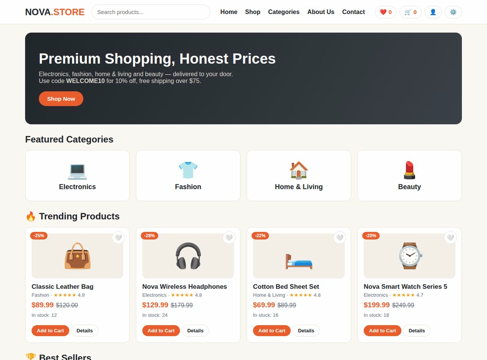

<h1 align="center">🛍️ NOVA.STORE</h1>

<p align="center"><b>Premium Shopping, Honest Prices.</b><br>
A real working online shop — built as a complete website project.</p>

<p align="center">
  <a href="https://nova-store-qb1r.onrender.com/"></a>
  
  
  
</p>

---

## 🌟 In Simple Words — What Is This?

**NOVA.STORE is an online shop, just like the shopping websites you already know**
(Daraz, Amazon, and others) — only smaller. It was built to show, from start to finish,
how a real shopping website works:

- People can **see products**, search for them, and read reviews
- They can **add items to a cart** and **place an order**
- The shop owner can **see every order** in a private dashboard and manage the products

It is a **demo shop**: everything works for real, but no real money is charged
and no real products are delivered. It is safe to click anything and try it.

### 🔗 Try the shop right now → [nova-store-qb1r.onrender.com](https://nova-store-qb1r.onrender.com/)

> ⏳ **Please wait on the first visit.** The shop runs on a free server that "sleeps"
> when nobody is visiting. The first page can take **30–50 seconds** to wake up —
> after that it is fast. This is normal, the shop is not broken.

---

## 🖱️ Try It Yourself — In 2 Minutes

1. Open the shop: **[nova-store-qb1r.onrender.com](https://nova-store-qb1r.onrender.com/)** and wait a few seconds
2. Scroll and pick any product — for example the **headphones** — and click it
3. Click **Add to Cart**, then open the cart (top right corner)
4. Click **Proceed to Checkout** and fill in any name and address (demo — nothing is really sent)
5. In the **Promo code** box, type the code yourself: **WELCOME10** — you get **10% off**
6. Click **Place Order** — your order is confirmed 🎉
7. Now click the **⚙️ gear button** (top right) — this is the **owner's dashboard**.
   Your order is already there. This is exactly what a real shop owner sees.

---

## 📸 See the Shop

<p align="center"><b>🏠 The Homepage</b> — where every visitor lands</p>
<p align="center"></p>

<p align="center"><b>🎧 A Product Page</b> — price, discount, colours, and customer reviews</p>
<p align="center"></p>

<p align="center"><b>⚙️ The Owner's Dashboard</b> — sales, orders and stock, all in one place</p>
<p align="center"></p>

---

## 🛍️ What Can You Do in This Shop?

| You want to… | Just do this |
|---|---|
| Find something quickly | Type its name in the **search bar** at the top |
| See only one type of product | Click a **category** — Electronics, Fashion, Home & Living, or Beauty |
| Get **10% off** | Type **WELCOME10** in the promo box at checkout |
| Get **free delivery** | Order **$75 or more** — delivery becomes free |
| Save something for later | Click the **heart ❤️** on any product (your wishlist) |
| Buy something | Add to cart → checkout → **Place Order** (demo — no real payment) |
| See your past orders | Create a free account, then open **My Orders** |
| Run the shop (owner view) | Click the **⚙️ gear button** — no password needed in this demo |

## ✨ Everything the Shop Can Do

**For visitors & customers**
- A welcoming homepage with categories, trending products, best sellers, new arrivals and special deals
- 12 products with photos, prices, discounts, star ratings and customer reviews — you can even write your own review
- Search and filters (by price and rating), and different ways to sort products
- A shopping cart and wishlist that remember your items
- Checkout with delivery choices, and an order confirmation page
- Personal accounts: sign up, log in, save your delivery address, see your order history

**For the shop owner (the ⚙️ dashboard)**
- See total sales, total orders, customers and products at a glance
- A chart showing which category earns the most
- Read every order and change its status (for example: "on the way")
- Add new products, change prices, or fix stock numbers — the shop updates instantly

---

## ❓ Common Questions

**Is this a real shop? Can I really buy something?**
It works like a real shop, but it is a **demo** — orders are practice only.
No money is taken and nothing is delivered.

**Do I need to install anything to visit the shop?**
No. Just open the [live link](https://nova-store-qb1r.onrender.com/) in any browser,
on a phone or a computer.

**Why did the first page load slowly?**
The free server sleeps when the shop has no visitors. The first visit wakes it up
(30–50 seconds). After that, everything is quick.

**Is the discount code a secret?**
No — **WELCOME10** is for every visitor. Type it yourself in the promo box at checkout;
the grey text in the box is only an example, the discount applies when you actually type it.

**Who made this?**
A software engineering student (see the bottom of this page) — as a learning project
that covers the full journey: designing the shop, building it, putting the code on GitHub,
and publishing it live on the internet.

---

## 🔧 For Technical Readers

<details>
<summary><b>How the website works (architecture)</b></summary>

```
┌────────────────────────┐      REST API       ┌──────────────────────┐
│  Browser               │  ───────────────►   │  server.py           │
│  HTML · CSS · JavaScript│   JSON requests    │  Python 3 stdlib     │
│  (static/ folder)      │  ◄───────────────   │  http.server         │
└────────────────────────┘                     └──────────┬───────────┘
                                                          │ SQL
                                                   ┌──────▼───────────┐
                                                   │  SQLite (nova.db)│
                                                   │  auto-created    │
                                                   └──────────────────┘
```

1. **Frontend** (`static/`) — a single-page app. It fetches products from the API and renders
   every view in the browser: home, shop, product, cart, checkout, account, admin.
2. **Backend** (`server.py`) — a REST API built **only on Python's standard library**
   (`http.server`). No Flask, no Django, nothing to install. It serves the frontend,
   processes orders, accounts and reviews, and **decrements stock automatically** on every order.
3. **Database** (`nova.db`) — SQLite, created automatically on first run with the 12-product
   catalogue. Passwords are stored as **SHA-256 hashes** — never in plain text.

</details>

<details>
<summary><b>Tech stack & project structure</b></summary>

| Part | Technology |
|---|---|
| Frontend | HTML · CSS · JavaScript (vanilla, in `static/`) |
| Backend | Python 3 standard library — `server.py` (REST API, zero frameworks) |
| Database | SQLite — `nova.db` (auto-created on first run) |
| Charts | CSS bars in the Admin dashboard (no library) |
| Hosting | Render (free plan) — the same code runs on any computer |

```
Nova-store-/
├── server.py              ← backend + database + API
├── run.bat                ← Windows double-click launcher
├── static/
│   ├── index.html
│   ├── app.js
│   └── styles.css
├── screenshots/           ← screenshots used in this README
└── README.md
```

</details>

<details>
<summary><b>Run it on your own computer</b></summary>

**You need:** Python 3 — and nothing else. No pip installs, no npm, no internet needed.

**Windows (easiest):** download/clone this repo → double-click **`run.bat`** → browser opens at http://localhost:8000

**Any computer (terminal):**

```bash
python server.py        # Mac/Linux may need: python3 server.py
```

Open http://localhost:8000 · stop with **Ctrl+C** · delete `nova.db` to reset the store.

</details>

---

<p align="center"><i>NOVA.STORE also exists as a Muse-hosted version (React + TypeScript + Bun + Drizzle ORM + SQLite).
This repo is the portable copy of the same shop with the same features, in the simplest possible
stack so anyone can run it anywhere. Demo / learning project — not for real payments or real customer data.</i></p>

<p align="center"><b>Built by Yasir Hafeez</b> — Software Engineering student, MUET SZAB Campus, Khairpur Mirs<br>
<a href="https://github.com/yasirhafeez10">github.com/yasirhafeez10</a> · <a href="https://nova-store-qb1r.onrender.com/">Live Shop</a></p>
