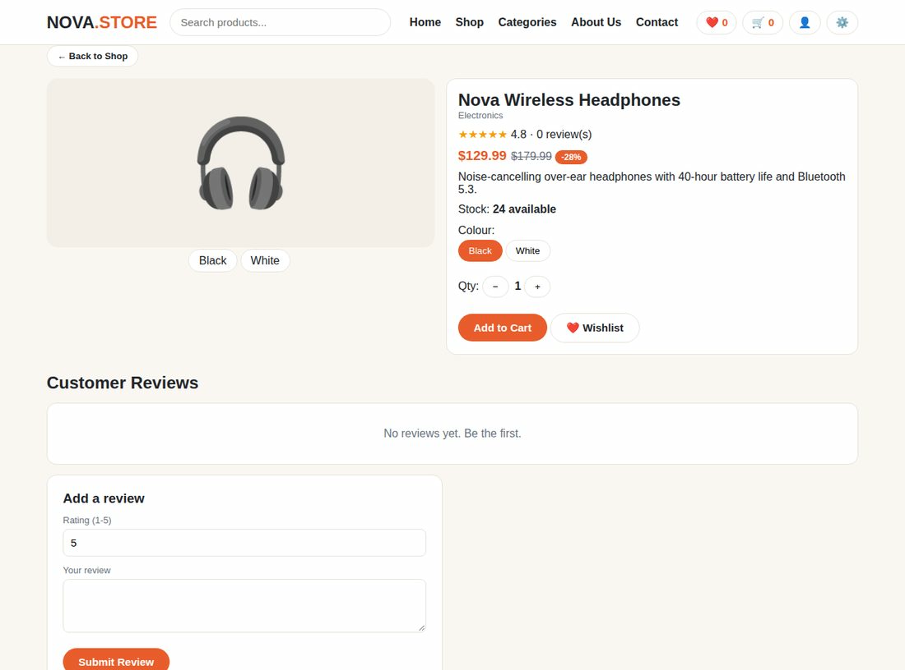
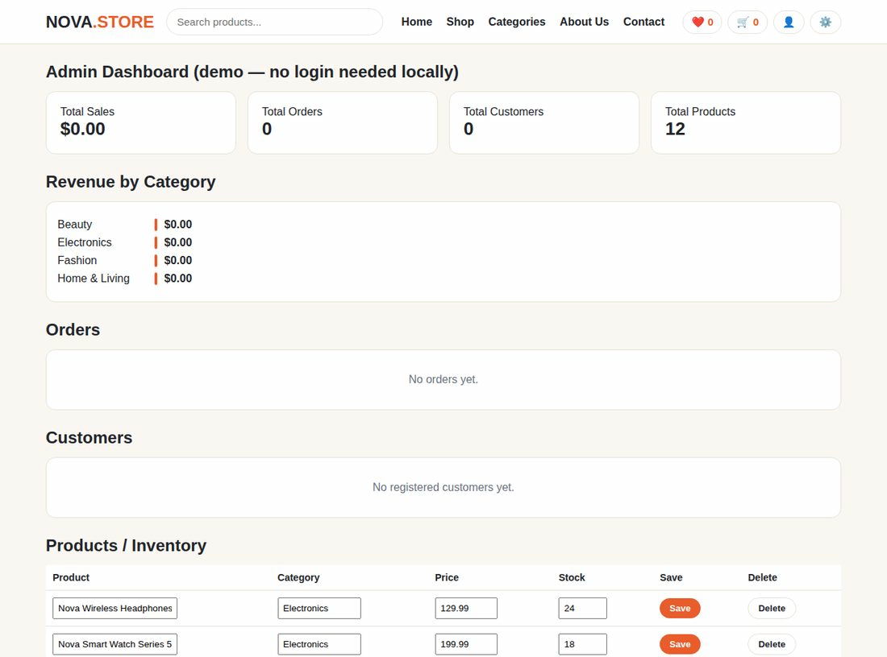

<h1 align="center">🛍️ NOVA.STORE</h1>

<p align="center"><b>Premium Shopping, Honest Prices.</b><br>
A complete full-stack e-commerce website — shop, accounts, checkout & admin dashboard.</p>

<p align="center">
  <a href="https://nova-store-qb1r.onrender.com/"></a>
  
  
  
</p>

<p align="center"><b>🔗 Live Demo → <a href="https://nova-store-qb1r.onrender.com/">nova-store-qb1r.onrender.com</a></b><br>
<i>First load may take ~30–50 seconds — the free hosting plan wakes the server up.</i></p>

---

## 📸 Screenshots

<p align="center"><b>🏠 Homepage</b> — hero, featured categories, trending products</p>
<p align="center"></p>

<p align="center"><b>🎧 Product Page</b> — price & discount, colour choice, quantity, customer reviews</p>
<p align="center"></p>

<p align="center"><b>⚙️ Admin Dashboard</b> — sales stats, revenue by category, orders, customers, inventory</p>
<p align="center"></p>

---

## ✨ Features

| 🛒 For Customers | ⚙️ For the Admin |
|---|---|
| Homepage: hero, featured categories, trending, best sellers, new arrivals, deals, testimonials, newsletter | Sales / orders / customers / products stats at a glance |
| Shop: 12 products in Electronics, Fashion, Home & Living, Beauty | Revenue-by-category chart |
| Search, category, max-price & min-rating filters; sort by price / newest / popularity; Load More | Order management — view orders, update status |
| Product page: size & colour options, quantity, ratings, reviews (add your own), related products | Customer list |
| Cart & wishlist saved in the browser | Inventory — add / edit / delete products & stock |
| **Promo code `WELCOME10` = 10% off** · free shipping over $75 · Express option | |
| Checkout with validation & order confirmation *(demo — no real payment)* | |
| Accounts: register, login, password reset, saved addresses, order history | |

> [!TIP]
> Try it on the [live demo](https://nova-store-qb1r.onrender.com/): add a product to the cart,
> type **WELCOME10** in the promo box at checkout, and place a demo order —
> then open the ⚙️ Admin dashboard to see it appear. *(Admin is open in this demo — no login needed.)*

---

## ⚙️ How the Website Works

```
┌────────────────────────┐      REST API       ┌──────────────────────┐
│  Browser               │  ───────────────►   │  server.py           │
│  HTML · CSS · JavaScript│   JSON requests    │  Python 3 stdlib     │
│  (static/ folder)      │  ◄───────────────   │  http.server         │
└────────────────────────┘                     └──────────┬───────────┘
                                                          │ SQL
                                                   ┌──────▼───────────┐
                                                   │  SQLite (nova.db)│
                                                   │  auto-created    │
                                                   └──────────────────┘
```

1. **Frontend** (`static/`) — a single-page app. It fetches products from the API and renders
   every view in the browser: home, shop, product, cart, checkout, account, admin.
2. **Backend** (`server.py`) — a REST API built **only on Python's standard library**
   (`http.server`). No Flask, no Django, nothing to install. It serves the frontend,
   processes orders, accounts and reviews, and **decrements stock automatically** on every order.
3. **Database** (`nova.db`) — SQLite, created automatically on first run with the 12-product
   catalogue. Passwords are stored as **SHA-256 hashes** — never in plain text.

## 🧰 Tech Stack

| Part | Technology |
|---|---|
| Frontend | HTML · CSS · JavaScript (vanilla, in `static/`) |
| Backend | Python 3 standard library — `server.py` (REST API, zero frameworks) |
| Database | SQLite — `nova.db` (auto-created on first run) |
| Charts | CSS bars in the Admin dashboard (no library) |
| Hosting | Render (free plan) — the same code runs on any computer |

## 📁 Project Structure

```
Nova-store-/
├── server.py              ← backend + database + API
├── run.bat                ← Windows double-click launcher
├── static/
│   ├── index.html
│   ├── app.js
│   └── styles.css
├── screenshots/           ← screenshots used in this README
└── README.md
```

## ▶️ Run It Locally

**You need:** Python 3 — and nothing else. No pip installs, no npm, no internet needed.

**Windows (easiest):** download/clone this repo → double-click **`run.bat`** → browser opens at http://localhost:8000

**Any computer (terminal):**

```bash
python server.py        # Mac/Linux may need: python3 server.py
```

Open http://localhost:8000 · stop with **Ctrl+C** · delete `nova.db` to reset the store.

---

<p align="center"><i>NOVA.STORE also exists as a Muse-hosted version (React + TypeScript + Bun + Drizzle ORM + SQLite).
This repo is the portable copy of the same store with the same features, in the simplest possible
stack so anyone can run it anywhere. Demo / learning project — not for real payments or real customer data.</i></p>

<p align="center"><b>Built by Yasir Hafeez</b> — Software Engineering student, MUET SZAB Campus, Khairpur Mirs<br>
<a href="https://github.com/yasirhafeez10">github.com/yasirhafeez10</a></p>
